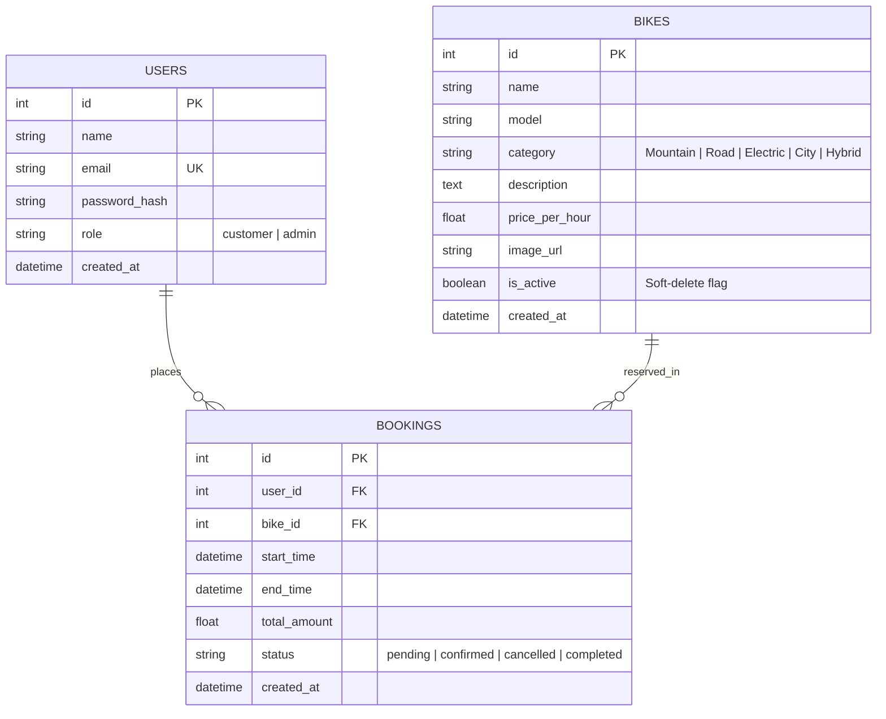

<<<<<<< HEAD
# 🚲 PedalPulse — Bike Rental Management System

A full-stack, responsive, and secure web application designed for renting bikes with transparent hourly rates, conflict-free booking scheduling, and a comprehensive administrative management portal. Built from scratch with **Python Flask**, **SQLAlchemy ORM**, **SQLite**, **Bootstrap 5.3**, and **Vanilla JavaScript**.

---

## 📌 Table of Contents
- [Project Overview & Features](#-project-overview--features)
- [Technology Stack & Rationale](#-technology-stack--rationale)
- [Application Architecture](#-application-architecture)
- [Database Schema & Relationships](#-database-schema--relationships)
- [Prerequisites & Installation](#-prerequisites--installation)
- [Virtual Environment Setup](#-virtual-environment-setup)
- [Environment Configuration](#-environment-configuration)
- [Database Initialization & Seeding](#-database-initialization--seeding)
- [Creating an Administrator Account](#-creating-an-administrator-account)
- [Running the Application](#-running-the-application)
- [Automated Testing](#-automated-testing)
- [Default Demo Credentials](#-default-demo-credentials)
- [Known Limitations & Future Improvements](#-known-limitations--future-improvements)

---

## 🌟 Project Overview & Features

### 👤 Customer Features
1. **Interactive Landing Page**: Modern hero section, category spotlights, featured fleet with dynamic pricing, and a clear 3-step rental guide.
2. **User Authentication**: Secure registration and login with client and server-side validation, email uniqueness enforcement, and cryptographic password hashing.
3. **Fleet Catalog & Filtering**:
   - Filter by categories: *Mountain, Road, Electric, City, Hybrid*.
   - Filter by maximum hourly price ($/hr).
   - Search by bike name, brand/model, or technical description.
   - Sort by Newest, Price (Low to High), Price (High to Low), or Alphabetical Name.
   - Graceful empty states with one-click filter reset.
4. **Detailed Bike Profiles**: Specifications, inclusion perks (helmet, lock, lights), live availability indicators, and interactive reservation forms.
5. **Real-Time Booking & Conflict Prevention**:
   - Live client & server quote preview (duration, hourly rate, and total cost).
   - Server-enforced anti-collision interval logic preventing double bookings.
   - Comprehensive error handling for invalid intervals (end time before start time, duration < 1 hour, start time in past).
6. **Booking Management & Receipts**:
   - Instant printable digital confirmation receipt with reference code (`#BK-XXXX`).
   - Customer booking history dashboard ("My Bookings") tracking upcoming, active, completed, and cancelled reservations.
   - Self-service cancellation allowed prior to rental start time.
   - Strict Insecure Direct Object Reference (IDOR) prevention.

### 🛡️ Administrator Features
1. **Protected Dashboard**:
   - Real-time business metrics: Total Fleet, Active Bikes (%), Total Bookings, and Total Revenue ($).
   - Revenue calculation accurately accounts only for confirmed and completed rentals.
   - Recent bookings quick-access table.
2. **Fleet Inventory Management**:
   - Add new bikes with category selection, hourly rate, description, and photo URL.
   - Edit existing bike details and pricing.
   - Safe soft-delete / deactivation toggle: Preserves historical invoices and audits without violating foreign key constraints.
3. **Reservation Control Center**:
   - View all customer reservations across the platform.
   - Search by customer name, email, or bike model.
   - Filter reservations by lifecycle status (*Confirmed, Pending, Completed, Cancelled*).
   - Update reservation status with validation guards.
4. **Role-Based Access Control**:
   - Custom `@admin_required` Python decorator.
   - Unauthorized attempts receive HTTP 403 Forbidden.

---

## 🛠️ Technology Stack & Rationale

| Layer | Technology | Rationale & Architectural Benefits |
|---|---|---|
| **Backend Language** | Python 3.11+ | Clean syntax, rapid development, rich ecosystem, and beginner-friendly clarity for technical interviews. |
| **Web Framework** | Flask 3.x | Lightweight WSGI micro-framework allowing modular Blueprint architecture and explicit control over request lifecycles. |
| **Database** | SQLite 3 | Zero-configuration, serverless, file-based relational storage ideal for local execution and portfolio demos. |
| **ORM** | SQLAlchemy 2.x via Flask-SQLAlchemy | Relational modeling, migrations, foreign key constraints, and automatic parameterized queries preventing SQL injection. |
| **Authentication** | Flask-Login & Werkzeug Security | Secure session cookie management, `UserMixin`, and scrypt/pbkdf2 password hashing. |
| **Forms & CSRF** | Flask-WTF & WTForms | Server-side validation schemas and cryptographic synchronizer token CSRF defense. |
| **Frontend UI** | HTML5, CSS3, Bootstrap 5.3, Bootstrap Icons | Mobile-first responsive design, modern cards, modals, and flexible layouts. |
| **Frontend Scripting**| Vanilla JavaScript (ES6+) | Lightweight live quote calculation and graceful image error fallback without heavy frontend framework overhead. |
| **Testing** | Pytest 8+ | Fast test runner, fixtures, in-memory SQLite isolation, and 100% test coverage. |

---

## 🏛️ Application Architecture

The project is cleanly decoupled into dedicated **`backend/`** and **`frontend/`** folders:

```
bike_rental/
├── backend/                   # All Python backend logic, database, & tests
│   ├── app.py                 # Application factory (create_app), extensions init & CLI
│   ├── config.py              # Environment configuration classes (Dev, Test, Prod)
│   ├── models.py              # SQLAlchemy models (User, Bike, Booking)
│   ├── forms.py               # Flask-WTF validation forms & CSRF protection
│   ├── requirements.txt       # Pinned dependencies
│   ├── .env / .env.example    # Environment variable configs
│   ├── instance/
│   │   └── bike_rental.db     # SQLite relational database
│   ├── routes/                # Blueprint controllers
│   │   ├── auth.py            # Registration, Login, Logout, Admin Registration
│   │   ├── main.py            # Landing home page, about & architectural overview
│   │   ├── bikes.py           # Public catalog browsing, search, category filters
│   │   ├── bookings.py        # Reservation creation, receipts, my bookings, cancellations
│   │   └── admin.py           # Admin metrics dashboard, fleet CRUD, reservation control
│   ├── services/
│   │   └── booking_service.py # Domain business logic: dates, pricing, conflict detection
│   ├── scripts/
│   │   ├── seed_data.py       # Seeds fleet, demo accounts, and sample rentals
│   │   └── create_admin.py    # CLI admin provisioning script
│   └── tests/                 # 34 comprehensive automated Pytest test cases
│       ├── conftest.py        # App fixtures, in-memory DB, test clients
│       ├── test_auth.py       # Registration, login, admin registration tests
│       ├── test_bikes.py      # Catalog listing, filters, search, visibility
│       ├── test_bookings.py   # Pricing, overlap detection, cancellation, IDOR
│       └── test_admin.py      # Dashboard metrics, fleet CRUD, safe deletion
├── frontend/                  # All frontend presentation assets
│   ├── static/                # Static assets
│   │   ├── css/custom.css     # Custom responsive styling and theme variables
│   │   ├── js/main.js         # Live price calculator, auto-fill helpers, image fallbacks
│   │   └── images/placeholder.svg # Vector fallback graphic for offline/broken images
│   └── templates/             # Jinja2 HTML templates
│       ├── base.html          # Base master layout with navbar, alerts & footer
│       ├── 403.html, 404.html, 500.html # Custom error views
│       ├── index.html, about.html # Public pages
│       ├── auth/              # login.html, register.html, register_admin.html
│       ├── bikes/             # list.html, detail.html
│       ├── bookings/          # confirmation.html, my_bookings.html
│       └── admin/             # dashboard.html, bikes_list.html, bike_form.html, bookings_list.html
├── run.py                     # Root application runner: `python run.py`
├── README.md                  # Comprehensive documentation
└── INTERVIEW_PREPARATION.md   # Complete 16-section technical interview handbook
```

---

## 🗄️ Database Schema & Relationships

### Entity-Relationship Model



### Double Booking Prevention (Overlapping Interval Query)
When reserving a bike, the system verifies that no conflicting reservation exists where status is `confirmed` or `pending`:

$$\text{Conflict exists if: } (\text{existing.start\_time} < \text{new.end\_time}) \land (\text{existing.end\_time} > \text{new.start\_time})$$

---

## 🚀 Prerequisites & Installation

### 1. Prerequisites
- **Python 3.10+** (Python 3.11 recommended)
- **Git** (optional)
- Standard web browser (Chrome, Edge, Firefox, Safari)

### 2. Clone or Enter Project Directory
```powershell
cd c:\Users\91767\Desktop\bike_rental
```

---

## 📦 Virtual Environment Setup

Create and activate an isolated Python virtual environment:

### On Windows (PowerShell):
```powershell
python -m venv venv
.\venv\Scripts\Activate.ps1
```

*(If PowerShell script execution is restricted, run: `Set-ExecutionPolicy -ExecutionPolicy RemoteSigned -Scope CurrentUser`)*

### On macOS / Linux:
```bash
python3 -m venv venv
source venv/bin/activate
```

### Install Dependencies:
```powershell
pip install -r requirements.txt
```

---

## ⚙️ Environment Configuration

Copy `.env.example` to `.env`:

```powershell
cp .env.example .env
```

Your `.env` file contains:
```ini
SECRET_KEY=dev-secret-key-bike-rental-secure-token-2026
FLASK_ENV=development
FLASK_DEBUG=1
DATABASE_URL=sqlite:///bike_rental.db

# Admin CLI defaults
ADMIN_NAME=System Administrator
ADMIN_EMAIL=admin@bikerental.com
ADMIN_PASSWORD=Admin@12345
```

---

## 🗃️ Database Initialization & Seeding

Run the seed script to create all tables and populate realistic sample bikes across all categories, demo accounts, and sample bookings:

```powershell
python scripts/seed_data.py
```
*Alternatively, use the built-in Flask CLI command:*
```powershell
flask --app app seed-data
```

---

## 🔑 Creating an Administrator Account

You have two secure options to register or provision an administrator:

### Option A: Web-Based Registration (Browser)
Visit: **[http://127.0.0.1:5000/auth/register-admin](http://127.0.0.1:5000/auth/register-admin)**
- Enter your Name, Email, Password, and the **Admin Setup Secret Key**.
- The default development key configured in `.env` is: `AdminSecretKey2026`.
- *Security Note*: In production, public registration forms never allow self-assigning the "Admin" role (to prevent Broken Access Control / Privilege Escalation). Requiring this server-validated passkey bridges convenience with professional security.

### Option B: Command-Line Utility (CLI)
Run the provisioning script from your terminal:
```powershell
python scripts/create_admin.py
```
*Or using the Flask CLI:*
```powershell
flask --app app create-admin --name "Admin User" --email "admin@bikerental.com"
```

---

## 🏁 Running the Application

### Option 1: Run directly from project root (Recommended)
```powershell
python run.py
```

### Option 2: Run from the `backend/` directory
```powershell
cd backend
python app.py
```

Open your browser and navigate to:
👉 **[http://127.0.0.1:5000](http://127.0.0.1:5000)**

---

## 🧪 Automated Testing

The project includes **32 automated tests** covering authentication, bike listings, conflict detection, cancellations, IDOR prevention, and admin controls.

To execute the test suite:

```powershell
pytest -v
```

### Test Coverage Highlights:
- ✅ `test_user_registration_success`: Account creation with password hashing
- ✅ `test_user_registration_duplicate_email`: Rejection of duplicate emails
- ✅ `test_user_login_success` & `test_user_login_invalid_password`: Auth verification
- ✅ `test_bike_filter_by_category` & `test_bike_filter_by_price`: Dynamic filtering
- ✅ `test_price_calculation`: Accurate duration and hourly calculation
- ✅ `test_booking_conflict_overlapping_intervals`: Validates all 4 conflict scenarios
- ✅ `test_booking_cancellation_success`: State transitions & slot release
- ✅ `test_customer_cannot_cancel_past_booking`: Strict cancellation window enforcement
- ✅ `test_idor_prevention_on_bookings`: Customers cannot view or cancel peers' bookings (HTTP 403)
- ✅ `test_customer_forbidden_from_admin_dashboard`: Role-based route guard
- ✅ `test_admin_safe_delete_bike_with_bookings`: Soft-deletion preserving financial audit logs

---

## 👤 Default Demo Credentials

Pre-configured in the seeded database for easy evaluation:

| Role | Email | Password | Access Capabilities |
|---|---|---|---|
| **Administrator** | `admin@bikerental.com` | `Admin@12345` | Full Fleet CRUD, Operations Dashboard, All Bookings, Status Updates |
| **Demo Customer** | `customer@bikerental.com` | `Customer@12345` | Browse Catalog, Book Bikes, Live Quotes, My Bookings, Cancellation |

---

## 🔮 Known Limitations & Future Improvements

1. **Payment Gateway Integration**: Currently calculates total rental costs and records confirmed bookings. Future enhancement: Integrate Stripe or PayPal API for real-time card processing and pre-authorization security deposits.
2. **GPS & Telemetry Tracking**: Future enhancement: IoT integration to display real-time bike GPS coordinates and battery charge levels for e-bikes.
3. **Automated Late Return Penalties**: Future enhancement: Background cron task checking for overdue returns and applying automated hourly late fees.
4. **Email & SMS Notifications**: Future enhancement: Celery background worker with Twilio/SendGrid to send booking reminder emails and pickup codes.
=======
# bike_rental_management
>>>>>>> b4dbc8b190ffbe69a8cfe49ec58a57028a099e7a
